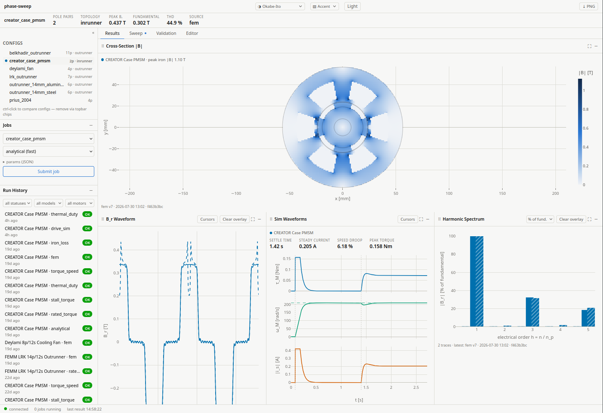
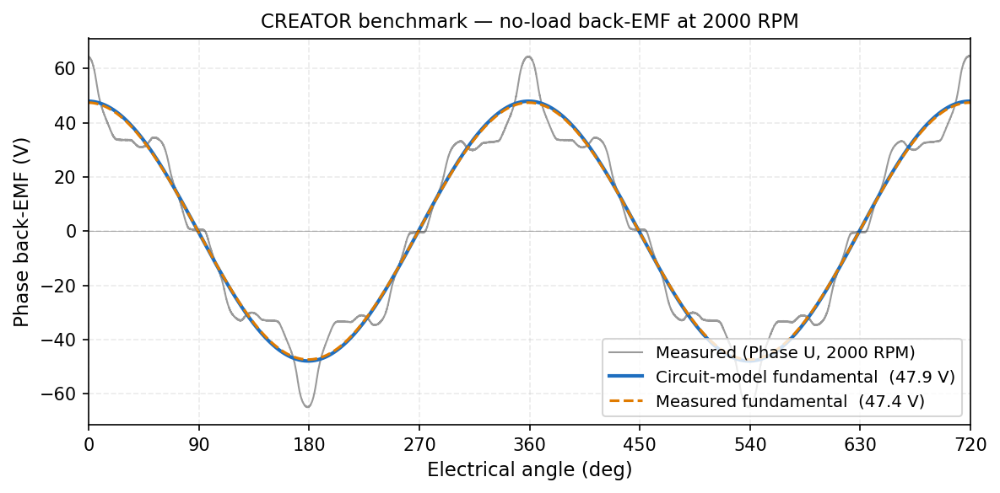
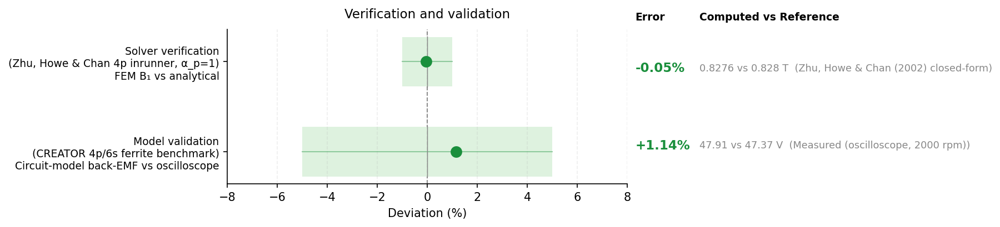

# phase-sweep

Electromagnetic design sweeps: analytical, FEM, and drive models, checked
against measured data. Use them from a Python API, web dashboard, or MCP
server. Covers PMSM and induction machines, and integrates with
[motulator](https://github.com/Aalto-Electric-Drives/motulator) and
[NGSolve](https://ngsolve.org/) through optional dependencies.



## What it does

phase-sweep reads a motor definition from TOML and runs the models that its
inputs support. A motor with geometry can use the analytical and FEM field
solvers; one with only circuit parameters can still produce torque-speed
envelopes, thermal estimates, and motulator drive simulations. The bundled
motors (`motors/` plus the validation anchors under `data/`) cover radial
and axial-flux machines, including SPM, IPM, outrunner, SynRM, Halbach,
and inset-magnet examples. Published and measured data are
included where licensing permits.

Sweeps can run in parallel and store their results in an append-only JSONL
file. A local browser dashboard runs jobs, plots stored results, and compares
them with imported measurements. An AI agent can submit jobs and read results
over [MCP](docs/mcp.md), including model caveats about assumptions and
omissions.

## Features

**Field solvers**
- Closed-form air-gap field (Zhu & Howe 2002), inrunner and outrunner
- NGSolve 2D FEM: slotted or smooth-bore stators, linear or nonlinear iron,
  Maxwell-stress torque
- Cogging torque and demagnetization screening
- Axial flux: quasi-3D layer model and multi-plane 2D FEM
- Harmonic decomposition, with an optional CuPy GPU path

**Circuit models**
- MTPA, stall torque, torque-speed envelope with field weakening
- S1 thermal-duty screening and Bertotti iron loss
- Induction machines: equivalent circuit, torque-slip with deep-bar and
  saturation tables, IEEE 112 parameter identification, time-harmonic cage FEM

**Drive simulation**
- motulator current-control transients, single- or two-mass load

**Sweeps and validation**
- Parallel parameter sweeps into a crash-safe JSONL result store
- Sensitivity analysis and bounded calibration against measurements
- Measured-data import and cross-validation; FEM checked against Zhu & Howe
  and [ElmerFEM](https://www.elmerfem.org/)
  ([validation report](docs/validation-report.md))

**Dashboard**
- Local browser dashboard: queue jobs, watch progress, plot results, edit
  motor configs

**Agent access (MCP)**
- MCP endpoint on the same server: per-motor model applicability, dry-run
  cost estimates, sweep tables, and results with headline metrics and model
  caveats; the dashboard's Agent tab shows tool calls and jobs

**Documentation:**
[motor TOML format](docs/motor-toml.md) |
[agent use (MCP)](docs/mcp.md) |
[architecture](docs/architecture.md) |
[validation report](docs/validation-report.md) |
[result-store contract](docs/result-store-contract.md) |
[glossary](docs/glossary.md) |
[references](docs/references.md)

## Scope and limitations

The field solvers are two-dimensional. The axial models combine several 2D
planes, while separate offline studies estimate 3D effects.

Saturation enters the PMSM circuit models only through a user-supplied
`[flux_map]` (consumed by `rated_torque`, `stall_torque`, `torque_speed`,
`operating_point`, `motor_thermal`, and `drive_sim`), and the induction
circuit models only through a user-supplied magnetizing table
(`[induction]` `L_m_vs_i`); no model predicts a saturated inductance from
geometry. AC winding losses and magnet eddy-current
losses are not implemented.

## Install

Requires Python 3.12+.

```bash
git clone https://github.com/jonelay/phase-sweep.git
cd phase-sweep

# Full install (all solvers + server + plotting + pytest)
pip install -e ".[all,test]"

# Or core only (circuit-parameter models and result store, no FEM/sim/plots)
pip install -e .
```

Optional extras:

| Extra | What it adds |
|-------|-------------|
| `[fem]` | NGSolve FEM field solver |
| `[sim]` | motulator drive simulation |
| `[viz]` | matplotlib plotting |
| `[server]` | FastAPI local server + dashboard |
| `[all]` | All of the above |
| `[gpu]` | GPU harmonics (requires CUDA 12.x) |
| `[mkl]` | Intel MKL BLAS backend for NGSolve |
| `[test]` | pytest + plugins |

NGSolve provides Python packages for supported Linux, macOS, and Windows
environments. See the [NGSolve installation guide](https://ngsolve.org/installation.html)
for current platform details.
The circuit-parameter models and non-FEM CLI paths do not require NGSolve.

Or with [uv](https://docs.astral.sh/uv/):

```bash
uv venv .venv --python 3.12
uv sync --extra all --extra test
```

Run the tests:

```bash
uv run pytest -m "not fem and not slow"  # core CI lane
uv run pytest                            # all tests available in this environment
```

## Quick start

Compute the torque-speed envelope of the Prius 2004 IPM:

```python
from phasesweep import MODEL_REGISTRY, RunConfig, load_motor

motor = load_motor("motors/prius_2004.toml")
cfg = RunConfig(motor=motor, model="torque_speed")
envelope = MODEL_REGISTRY["torque_speed"].fn(cfg)
print(f"Peak torque: {envelope['tau_curve_peak'][0]:.0f} Nm")
print(f"Peak power:  {envelope['p_max_peak']/1000:.0f} kW")
```

Both numbers are constant-inductance over-predictions - see the
[saturation caveat](#torque-speed-envelope-prius-2004-ipm) below.

Compute the air-gap field of a motor with full geometry - analytically,
then with the 2D FEM solver, and compare:

```python
motor = load_motor("motors/belkhadir_outrunner.toml")

cfg = RunConfig(motor=motor, model="analytical", n_theta=720)
metrics = MODEL_REGISTRY["analytical"].fn(cfg)
print(f"Analytical B1: {metrics['fundamental']:.3f} T")
print(f"Back-EMF:      {metrics['backemf_fundamental']:.1f} V")

cfg = RunConfig(motor=motor, model="fem", n_theta=720)
metrics = MODEL_REGISTRY["fem"].fn(cfg)
print(f"FEM B1:        {metrics['fundamental']:.3f} T")
```

The analytical solver supports surface-mounted magnets with air between the
arcs. Inset rotors, including the bundled CREATOR motor, require the FEM model.

Launch the dashboard (needs the `[server]` extra):

```bash
phasesweep-server         # serves http://127.0.0.1:8000
```

It reads `motors/*.toml` and the result store in `output/` relative to
the working directory (the shipped motor definitions live in the source
repository, not in the wheel; `--motors-dir` points elsewhere), queues
solver jobs across worker processes, streams progress over WebSocket,
and plots stored waveforms, harmonics, and envelopes in the browser.
Downstream consumers of the store read rows against
`phasesweep.record_schema` and the
[result-store contract](docs/result-store-contract.md).

The same server exposes an [MCP](https://modelcontextprotocol.io/) endpoint
at `/mcp`, so an AI agent can check which models run on a motor, submit
jobs and sweeps, and read results. Each result comes with the model's
headline metrics and units, plus caveats drawn from its own provenance (for
example, a torque envelope computed with constant inductances). Jobs share
the dashboard's worker pool, and the dashboard's **Agent** tab plots the
designs the agent has explored and shows each tool call live. For Claude
Code:

```bash
claude mcp add --transport http phase-sweep http://127.0.0.1:8000/mcp
```

The server has no authentication; keep it on loopback unless something in
front of it authenticates. Tools, result caveats, cost planning, and limits
are in [docs/mcp.md](docs/mcp.md).

## CLI tools

| Command | Purpose |
|---------|---------|
| `phasesweep-check-motor` | Check a motor definition file for structural validity, input consistency, and model execution |
| `phasesweep-import` | Import measured data (JSON) into the result store |
| `phasesweep-crossval` | Compare computed vs measured results across motors |
| `phasesweep-calibrate` | Fit motor parameters to measured quantities |
| `phasesweep-server` | Local FastAPI server + browser dashboard |

Each command supports `--help`.

## Available models

`RunConfig(motor=..., model=<key>)` dispatches through `MODEL_REGISTRY`.
Each entry declares what it produces and which motor fields it needs;
a motor missing a required field fails validation before any solve.

| Key | Cost | Computes | Requires |
|-----|------|----------|----------|
| `analytical` | fast | Air-gap B_r waveform, fundamental, THD, back-EMF, flux linkage | geometry, magnet |
| `fem` | slow | No-load B_r waveform, \|B\| field grid, fundamental, peak iron flux density; Maxwell-stress torque when `j_s` is supplied | geometry, magnet, `mu_r_fe` |
| `analytical_axial` | fast | Air-gap B_z waveform, fundamental, THD, flux linkage (quasi-3D layer model) | axial geometry, magnet |
| `fem_axial` | slow | B_z waveform and fundamental from multi-plane Cartesian FEM | axial geometry, magnet, `mu_r_fe` |
| `cogging_torque` | slow | Peak-to-peak cogging torque, dominant harmonic order | geometry, magnet, `mu_r_fe` |
| `demag_screen` | slow | Minimum magnet flux density vs knee at fault current, demag margin | geometry, magnet, winding, `B_knee`; `i_fault` per run |
| `drive_sim` | medium | Speed/torque/current transients, settling time, droop | `R_s`, `L_d`, `L_q`, `psi_f`, `J` |
| `drive_sim_two_mass` | medium | `drive_sim` with a two-mass load; adds shaft torque | same, plus load params |
| `rated_torque` | fast | MTPA torque and angle at rated current, torque constant | `psi_f`, `I_rated` |
| `stall_torque` | fast | Voltage/current-limited stall torque | `psi_f`, `R_s`, drive limits |
| `torque_speed` | fast | Continuous + peak envelope, base speed, field-weakening range | `R_s`, `L_d`, `L_q`, `psi_f`, drive limits |
| `operating_point` | fast | Minimum-current dq point, voltages, modulation index, power factor, powers for a speed + torque demand | circuit, drive limits; `w_mech`, `tau_ref` per run |
| `thermal_duty` | fast | S1 verdict, copper loss, winding temperature over a duty profile | `psi_f`, `R_s`, duty profile |
| `motor_thermal` | fast | Steady winding / iron / magnet temperatures of a three-node network coupled to `operating_point` | `[thermal_network]`, `[iron]`, `alpha_Br`, circuit, drive limits; `w_mech`, `tau_ref`, `T_coolant` per run |
| `iron_loss` | fast | Hysteresis + eddy core loss at a given speed | `[iron]` |
| `im_equivalent_circuit` | fast | Induction-machine circuit at one slip: torque, currents, power factor, losses | `[induction]`, `R_s`; `slip` per run |
| `im_torque_slip` | fast | Torque-slip sweep: breakdown, starting and rated points | `[induction]`, `R_s` |
| `im_bar_impedance` | medium | Predicted deep-bar `R_2(f)` / `L_sigma_r(f)` tables from a single-slot-pitch harmonic FEM solve | cage `[geometry]`, `sigma_bar`, winding |
| `im_fem_harmonic` | slow | Full-machine time-harmonic FEM at one slip: current, power factor, torque, loss split, field grid; linear or saturating iron | cage `[geometry]` with stator slots, `[induction]` ratings, `R_s`, winding; `slip` per run |
| `im_fem_locked_rotor` | slow | Virtual blocked-rotor tests identified into `R_2(f)` / leakage tables; no-load sweep into `L_m(I_m)` when saturating | same as `im_fem_harmonic` |

Each model's full input and output contract is in `MODEL_REGISTRY`; the
TOML fields are documented in [docs/motor-toml.md](docs/motor-toml.md).
The `fem` quick-start call above is a no-load field solve and does not
return loaded torque. See
[docs/add-a-radial-pmsm.md](docs/add-a-radial-pmsm.md) for the staged
new-motor workflow.

The registry keys `backemf_capture`, `inductance_test`,
`resistance_test`, `torque_test`, `iron_loss_test`, and `airgap_flux_test`
are imported measurement record types used by `phasesweep-import` and the
cross-validation comparisons.

## Motor definition

Motors are TOML files. Only a pole-pair count is required (`name`
defaults to the filename stem);
each model declares which further fields it needs, so a circuit-only
motor (no geometry) runs the torque and envelope models, and the field
solvers require geometry. Minimal example:

```toml
[motor]
name = "example"
type = "SPMSM"

[circuit]
n_p = 4
R_s = 0.05       # Ohm per phase
L_d = 0.0002     # H
L_q = 0.0002     # H
psi_f = 0.012    # Wb per-phase peak

[drive]
U_DC = 48.0      # V
MAX_I_S = 30.0   # A peak
```

Sections, fields, units, and defaults are documented in
[docs/motor-toml.md](docs/motor-toml.md). The bundled [`motors/`](motors/)
files are worked examples with provenance comments. To add a new motor and
evaluate it, follow [docs/add-a-radial-pmsm.md](docs/add-a-radial-pmsm.md)
and `phasesweep-check-motor`.

## Verification and validation

### Torque-speed envelope (Prius 2004 IPM)

The Prius 2004 case exercises stall torque, MTPA angle, and the
torque-speed envelope for a 50 kW, 8-pole, V-shape NdFeB traction motor.
Circuit parameters come from ORNL teardown and dynamometer reports
([OSTI 885676](https://www.osti.gov/biblio/885676),
[OSTI 890029](https://www.osti.gov/biblio/890029)). It is not a validation
at high current: the constant-inductance model predicts about 905 N·m stall
torque against about 340 N·m measured on the ORNL dynamometer at 250 A
(+166 %), because L_q saturates. The test suite pins that prediction as a
regression value and checks the one-sided bound against the measurement;
the MTPA angle is checked against a plausible band, not a measured value.
See [docs/validation-report.md](docs/validation-report.md) for details.

### Solver verification (Zhu & Howe)

The NGSolve FEM solver is verified against the Zhu & Howe (2002) closed-form
air-gap field solution across reference inrunner and outrunner configurations.
Acceptance bounds and current results are documented in the
[validation report](docs/validation-report.md).

Radial and axial FEM results are also cross-checked against
[ElmerFEM](https://www.elmerfem.org/). Pinned comparison records in
`scripts/elmer_radial/` and `scripts/elmer_axial/` are exercised by the core
test suite; regenerating them requires a local ElmerSolver.

### Back-EMF and torque checks (CREATOR benchmark)

The [CREATOR](https://doi.org/10.3217/sns1d-77m43) open-benchmark PMSM
(sintered-ferrite inrunner; Muetze et al., COMPEL 2025) supplies measured
back-EMF data and published circuit parameters. Computed values, references,
tolerances, and errors are reported in the
[validation report](docs/validation-report.md).



The benchmark supplies ψ_f. The calculated back-EMF fundamental checks the
electrical-speed conversion and `E = ω_e·ψ_f`, not the field solver's prediction
of ψ_f. The validation report covers the separate MTPA angle, rated torque,
and nonlinear FEM field comparisons.

The measured waveform is trapezoidal, consistent with the nearly rectangular
ferrite magnets and the square-wave magnetization used by both field solvers.
The current comparison covers only the fundamental because the model does not
yet produce a back-EMF waveform.



## Reference data

The `data/prius_2004/` directory contains the
[Pyleecan](https://github.com/Eomys/pyleecan) machine-readable IPM
geometry and ORNL dynamometer reference values for the Toyota
Prius 2004 traction motor. See
[`data/prius_2004/README.md`](data/prius_2004/README.md) for sources and
declared assumptions.

The `data/creator_case_pmsm/` directory documents the reference data from
the CREATOR open-benchmark PMSM (Muetze et al., 2025); the data files
themselves are not redistributed. See
[`data/creator_case_pmsm/README.md`](data/creator_case_pmsm/README.md) for
attribution and citation information, and [License](#license) for terms.

## Dependencies

| Package | Purpose | License |
|---------|---------|---------|
| [NumPy](https://numpy.org/) / [SciPy](https://scipy.org/) | Numerical computation | BSD-3-Clause |
| [motulator](https://github.com/Aalto-Electric-Drives/motulator) (optional) | Synchronous machine drive simulation | MIT |
| [NGSolve](https://ngsolve.org/) (optional) | 2D finite element field solver | LGPL-2.1 |
| [Matplotlib](https://matplotlib.org/) (optional) | Plotting | PSF (BSD-compatible) |
| [FastAPI](https://fastapi.tiangolo.com/) + uvicorn (optional) | Local server + dashboard | MIT / BSD-3-Clause |
| [structlog](https://www.structlog.org/) + [tomli-w](https://github.com/hukkin/tomli-w) (optional) | Server logging, TOML export | MIT or Apache-2.0 / MIT |
| [CuPy](https://cupy.dev/) (optional) | GPU-accelerated harmonic decomposition | MIT |

## Package layout

The package layout and data-flow spine are described in
[docs/architecture.md](docs/architecture.md). Alongside the package:
`scripts/` (validation and maintenance tools), `tests/` (pytest suite with
`fem` and `slow` markers), `data/` (published, measured, and derived
validation data), and `motors/` (motor parameter files).

## Contributing

Bug reports, documentation fixes, validation datasets, and motor references
are welcome.
See [CONTRIBUTING.md](CONTRIBUTING.md) for setup and process.

Questions and discrepancy reports:
[GitHub Issues](https://github.com/jonelay/phase-sweep/issues).

## Citing

If you use phasesweep in a report or publication:

> J. Lay, *phasesweep: Electromagnetic design sweeps — analytical, FEM, and
> drive models*, 2026. https://github.com/jonelay/phase-sweep

## License

Code and data are licensed under [Apache-2.0](LICENSE), except for the
third-party data files listed below. The data consists of parameter values
transcribed from cited publications or measured by the project authors.
[NOTICE](NOTICE) credits the sources, and anyone who redistributes
`phasesweep` must include it (Apache-2.0 §4(d)).

| Files | License | Source |
|-------|---------|--------|
| `data/prius_2004/pyleecan_geometry.json` | Apache-2.0 | [Pyleecan](https://github.com/Eomys/pyleecan) |
| `data/creator_case_pmsm/`: files derived from the CREATOR dataset (not shipped) | [CC BY-NC-ND 4.0](https://creativecommons.org/licenses/by-nc-nd/4.0/) | Muetze et al., 2025 ([README](data/creator_case_pmsm/README.md)) |
| `data/creator_case_im/`: files fetched by `scripts/fetch_creator_im_dataset.py` (not shipped) | [CC BY-NC 4.0](https://creativecommons.org/licenses/by-nc/4.0/) | CREATOR IM dataset ([README](data/creator_case_im/README.md)) |
| `data/bmw_i3/`: `BMWi3_GeometryAutoCAD.dxf`, `FEMResults_1000rpm.xlsx`, and `flux_maps_7x7.json` (derived from the xlsx) | [CC BY 4.0](https://creativecommons.org/licenses/by/4.0/) | Gierczynski & Grzesiak, 2021 (NOTICE) |

`data/creator_case_im/creator_case_im.toml` is transcribed and therefore
Apache-2.0.
