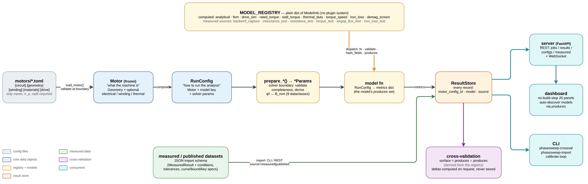
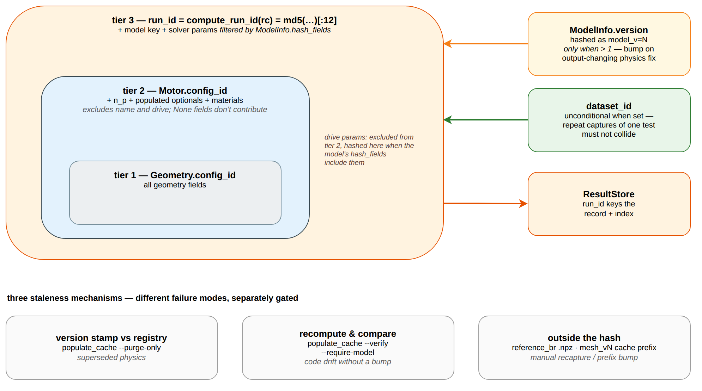
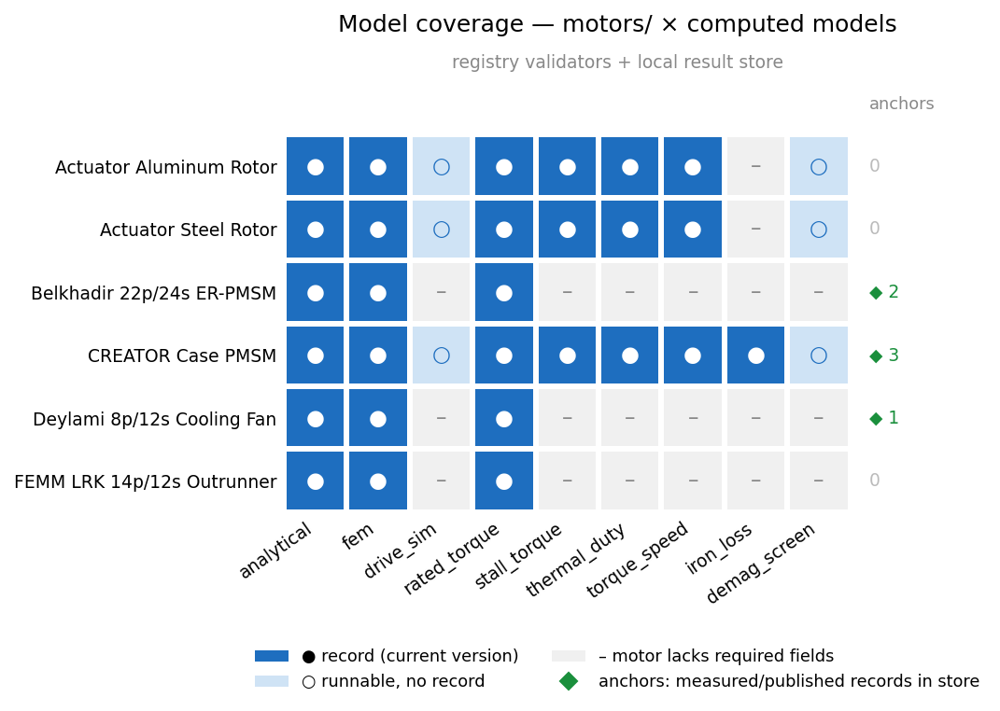

# Architecture

These figures show how a motor definition becomes a stored result, how result
IDs are computed, and which models have run for the bundled motors. Diagram
sources live in [`diagrams/`](diagrams/); [`diagrams/README.md`](diagrams/README.md)
records the source for each factual element and the repository revision checked.
The validation, simulation, and server subsystems do not yet have diagrams;
the same README documents the claim-table format used when adding one.

## Package layout

The package lives directly under `phasesweep/`. Its top-level Python modules
and packages divide configuration, computation, evidence, persistence, and
interactive consumers as follows; descriptions follow the package and module
docstrings (or, for asset-only directories, their entry-point source):

| Path | Responsibility |
| --- | --- |
| `machines/` | Machine definitions, geometry types, perturbations, and TOML loading. |
| `models/` | Rated-point and quasi-static performance models. |
| `solvers/` | Analytical and FEM field computation. |
| `simulation/` | Time-domain drive-simulation models. |
| `validation/` | Measurement comparison, cross-validation, and calibration. |
| `audit/` | Advisory induction-machine design checks against published diagnostic bands. |
| `server/` | Local FastAPI job manager, result-query API, and WebSocket progress service. |
| `dashboard/` | Static browser UI for configuration, jobs, results, sweeps, and validation. |
| `vis/` | Visualization utilities. |
| `registry.py` | Model metadata and execution-function registry. |
| `solver_params.py` | Shared solver-parameter derivation and motor-completeness validation. |
| `sweep_types.py` | Validated run configuration and result types. |
| `geo_parallel.py` | Geometry sweep generation and parallel execution. |
| `result_store.py` | Crash-safe incremental JSONL result storage. |
| `defaults.py` | Access to solver and geometry defaults from `defaults.toml`. |
| `check_motor.py` | Staged objective checks and evidence-level reporting for one motor TOML. |

## Data-flow spine



A motor TOML loads into a frozen `Motor` (validation at the boundary,
see [`motor-toml.md`](motor-toml.md)). `RunConfig` pairs that `Motor`
with a model key and solver params; the `prepare_*` factories (each
living next to its model's run function, on the shared derivation
utilities in `solver_params.py`) validate completeness and derive
`psi_f` ↔ `B_rem`,
so holding a params object means the `Motor` is ready for that solver.
`MODEL_REGISTRY` maps model keys to `ModelInfo` metadata and executable
model functions over their declared `produces` quantities. Results land in the `ResultStore`
carrying `motor_config_id`, `model`, and `source`; the crossval
comparison surface is derived from `produces` intersections rather than
hardcoded, and deltas are computed on request, never stored.

The figure is a full-width landscape (3.2:1); labels are legible at
docs-page width but not at README inline width.

## Model inventory

`MODEL_REGISTRY` in [`phasesweep/registry.py`](../phasesweep/registry.py) is
the model inventory and the source of truth for each key's source class, cost,
outputs, required motor and runtime fields, hash fields, version, validator,
and runner. Discover the current inventory and metadata programmatically with
`uv run python -c 'from phasesweep import MODEL_REGISTRY; print(*MODEL_REGISTRY.items(), sep="\n")'`;
the server and coverage generator consume this mapping directly, so this
overview does not duplicate its keys.

## Validation subsystem

`phasesweep/validation/` represents measured and published anchors as validated
`RunResult` records and imports them into the same `ResultStore` used by
computed models. Three stages form the evidence pipeline:

- **Import** — measured or published data enters as validated `RunResult`
  records, keyed by motor name so they survive TOML configuration changes.
- **Cross-validation** — resolves direct quantities, curves, bounds, and
  explicit key mappings between stored evidence and computed runs.
- **Calibration** — bounded perturbation of selected motor parameters against
  cross-validation residuals, with guards for circular, underdetermined, and
  insensitive fits.

`cli_import.py`, `cli_crossval.py`, and `cli_calibrate.py` expose those stages
without creating a second compute or persistence path.

## Simulation subsystem

`phasesweep/simulation/` is the registered time-domain branch of the main
pipeline: a motor supplies electrical, mechanical, and drive parameters, while
the `RunConfig` supplies a simulation plan and, for the two-mass model, load
mechanics. `prepare_drive_sim` validates and derives the plant parameters;
`sim_runner.py` builds and runs the motulator drive, extracts scalar response
metrics and downsampled waveforms, and returns the metrics dictionary through
the registry so the ordinary run identity and `ResultStore` path still apply.

## Local server and dashboard

`phasesweep/server/` layers phase-sweep motor loading, a `ResultStore`, and a
queued parallel job manager onto the local FastAPI/WebSocket service; its REST
routes submit registry models and sweeps, query current stored records, import
validation evidence, and manage editable user configurations. The static
`phasesweep/dashboard/` application consumes those APIs and stored-result
payloads to present job progress, run history, field and simulation waveforms,
sweep tables, model comparisons, validation summaries, and the config editor.

## Provenance and run identity



Identity is hashed in three tiers: `Geometry.config_id` over the
geometry fields, `Motor.config_id` over that plus `n_p`, populated
optionals, and materials (excluding name and drive), then
`compute_run_id` over the motor's id, the model key, and only the
solver params in that model's `hash_fields`. Two side-inputs modify the
run id — `model_v=N` when a model's version exceeds 1, and `dataset_id`
unconditionally when set, so repeat captures of one test cannot
collide.

Two staleness mechanisms sit outside the hash and need explicit
handling: version-stale records are purged by comparing the stamp
against the registry (`scripts/populate_cache.py --purge-only`), and records
written by changed code that never got a version bump are only caught
by recomputing (`scripts/populate_cache.py --verify`). Reference `.npz`
captures and the mesh-cache prefix are outside the hash entirely and
are recaptured or prefix-bumped by hand. See
[result-store-contract.md](result-store-contract.md) for the
portable specification of these rules, including test vectors for
downstream consumers.

## Model coverage



Rows are `motors/*.toml`, columns are the computed models in the
registry. Three states, one hue plus glyphs: a current-version record
in the store, runnable but no record yet, or the motor lacking fields
the model requires. The ◆ counts are measured and published records —
matched by motor *name*, not `motor_config_id`, because an imported
record pins the config id at import time and the TOML drifts past it as
it gains fields. The anchor belongs to the physical motor, not to a
config revision.

**This is a snapshot of one local store, not a project invariant.**
`output/` is gitignored, so the committed image reflects whichever
machine last rendered it. It is generated, never hand-drawn or
hand-edited:

```bash
uv run python scripts/populate_cache.py     # fill any gaps first
uv run python scripts/generate_readme_figures.py --fig 4
```

A grey cell is a statement about the motor file, not about the model:
`iron_loss` needs an `[iron]` section, `thermal_duty` and
`torque_speed` need circuit and thermal fields that the published
benchmark motors do not all carry. Light cells mean the model runs but
nothing was stored when the image was generated. The generation script is
the authority for inclusion policy.
