# Validation Report

Phase-sweep compares its electromagnetic models with published research,
manufacturer datasheets, and bench measurements. Reference data lives under
`data/`, with executable comparisons in `tests/crossval/`.

## Cross-Validation Results

The table summarizes the automated report. The notes below distinguish
measured comparisons, published calculations, fitted values, and bounds.

| Motor | Quantity | Computed | Reference | Error | Tol | Result | Source |
|-------|----------|---------|-----------|-------|-----|--------|--------|
| CREATOR Case PMSM | MTPA angle at 0.15 A | 12.3° | 10° | 23.0% | 25% | PASS | arXiv:2501.15921 |
| CREATOR Case PMSM | MTPA angle at 0.30 A | 20.6° | 20° | 3.2% | 15% | PASS | arXiv:2501.15921 |
| CREATOR Case PMSM | rated torque (Nm) | 0.107 | ≥ 0.10 | +6.8% | bound | PASS | arXiv:2501.15921 |
| Belkhadir ER-PMSM | B_ag fundamental (T) | 1.026 | 0.963 | 6.6% | 10% | PASS | IECON 2023 |
| Belkhadir ER-PMSM | back-EMF peak (V) | 67.5 | 67.5 | 0.0% | 8% | by construction (fitted `psi_f`) | IECON 2023 |
| Belkhadir ER-PMSM | flux linkage (Wb) | 0.097 | 0.100 | 3.0% | 30% | PASS | IECON 2023 |
| Belkhadir ER-PMSM | B_ag (FEM, T) | 1.020 | 0.963 | 6.0% | 10% | PASS | IECON 2023 |
| Belkhadir ER-PMSM | rated torque (Nm) | 25.1 | ≥ 24 | +4.5% | bound | PASS | IECON 2023 |
| Deylami Fan | B_ag peak (FEM, T) | 0.408 | 0.49 | 16.7% | 25% | PASS | TechRxiv |
| Deylami Fan | B_ag peak (analytical, T) | 0.365 | 0.49 | 25.5% | 25% | FAIL | TechRxiv |
| 14 mm Outrunner (Steel) | back-EMF (V) | 1.97 | 1.68 | 16.9% | 1% | FAIL | bench (ODrive) |

## Notes on Partial Results

**Belkhadir back-EMF:** `psi_f = 0.0977 Wb` in
`motors/belkhadir_outrunner.toml` is fitted to this 67.5 V reading, and the
analytical model reports `backemf_fundamental` from `psi_f` when it is set
(`backemf_source = "psi_f"`), so the 0.0% row is a consistency check, not a
validation. With `psi_f` unset, the field model's own back-EMF is 67.0 V
(−0.7%). The flux-linkage row is computed from `B_rem` and does not use
`psi_f`.

**Deylami Fan analytical B_ag_peak:** The analytical model exceeds tolerance
for this simplified slot geometry, while the FEM model passes. The
published reference itself is from a simplified 2D ANSYS Maxwell model, not a
physical measurement - both values are model-vs-model comparisons.

**14 mm Outrunner (Steel) back-EMF:** The 1.97 V prediction already
includes the computed end-effect factor (`k_end = 0.918`) and uses the
nominal N52 remanence of 1.45 T. The measured voltage is linear in speed
(R² = 0.99997), so the residual +17 % is model bias, not measurement
scatter; calibration absorbs it into an effective remanence of 1.24 T
(1.14 T without the end-effect factor). This is the project's main
calibration example; the motor TOML records the full accounting.

## Analytical vs FEM Agreement

The table compares the computed airgap flux density fundamental from the
analytical (Zhu & Howe subdomain) and nonlinear FEM (NGSolve damped Newton
by default, with Picard startup/fallback) solvers:

| Motor | Analytical B₁ (T) | FEM B₁ (T) | Delta |
|-------|-------------------|------------|-------|
| 14 mm Outrunner (Steel) | 1.004 | 0.998 | 0.5% |
| Belkhadir 22p/24s ER-PMSM | 1.026 | 1.020 | 0.6% |
| Deylami 8p/12s Cooling Fan | 0.453 | 0.445 | 1.6% |
| FEMM LRK 14p/12s | 0.950 | 0.945 | 0.5% |
| Zhu & Howe 8-pole inrunner | 0.565 | 0.564 | 0.2% |
| Zhu & Howe 8-pole outrunner | 0.552 | 0.552 | 0.0% |

CREATOR Case PMSM is absent from this table: its rotor uses
`magnet_mount = "inset"` (interpole iron), which the Zhu & Howe
subdomain model does not support. The analytical solver rejects this motor;
CREATOR's field comparisons use the nonlinear FEM path only.

## Per-Motor Details

### CREATOR Case PMSM

4-pole inrunner from the TU Graz CREATOR open benchmark
(DOI 10.3217/sns1d-77m43). The table above compares MTPA angles with published
values and checks rated torque against a one-sided bound. The rotor uses
inset magnets, so only the nonlinear FEM solver applies. The
measured back-EMF capture is an import gate, not a validation (the motor's
`psi_f` is the benchmark's own), and iron loss is excluded because
`B_core` was calibrated against the same measured loss curve. The
benchmark JSON is fetched locally by `scripts/fetch_creator_dataset.py`
and is not shipped.

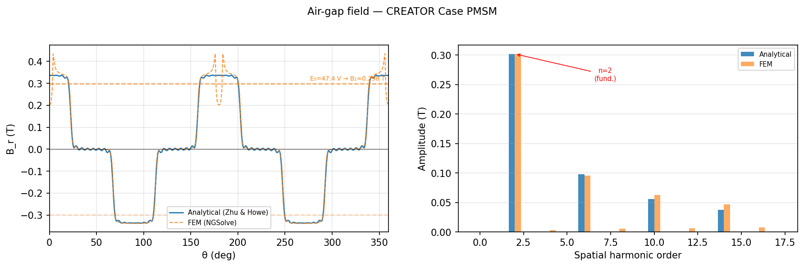

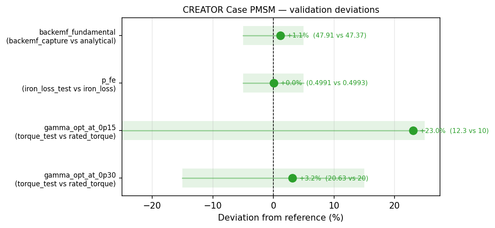

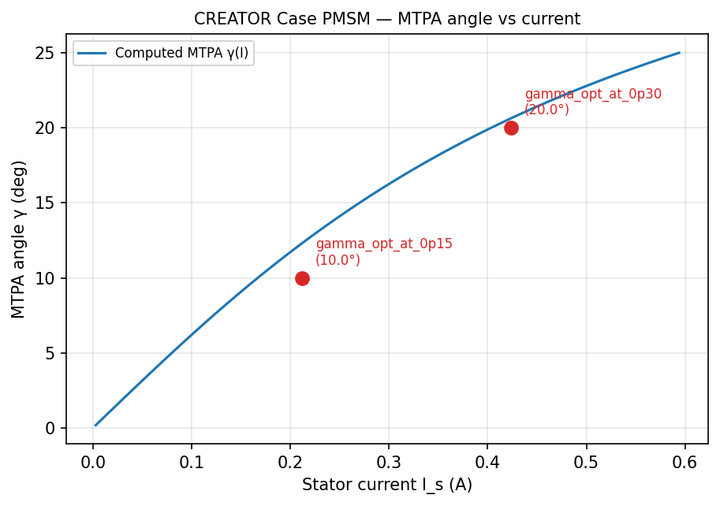

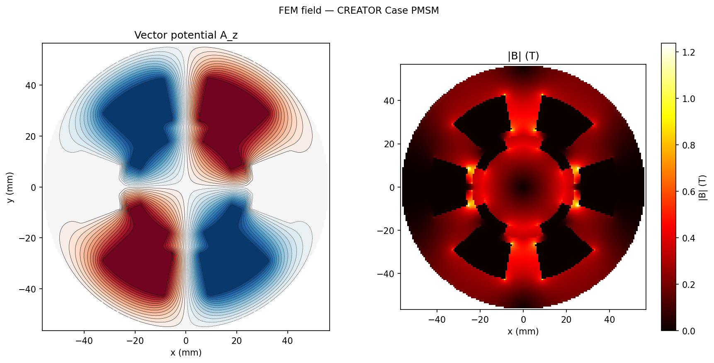

### Belkhadir 22p/24s ER-PMSM

22-pole / 24-slot external-rotor PMSM from Belkhadir et al. (IECON 2023).
All rows pass, but none is an independent measured comparison.

- The air-gap reference (0.963 T) is the paper's flat-top formula value
  (0.776 T) converted to a fundamental with this project's own
  (4/π)·sin(π·α_p/2) factor.
- The back-EMF row matches by construction (fitted `psi_f`).
- The flux-linkage tolerance is 30 % because the fundamental model misses
  this fractional-slot topology's sub-harmonic coupling.
- Rated torque is a one-sided bound.

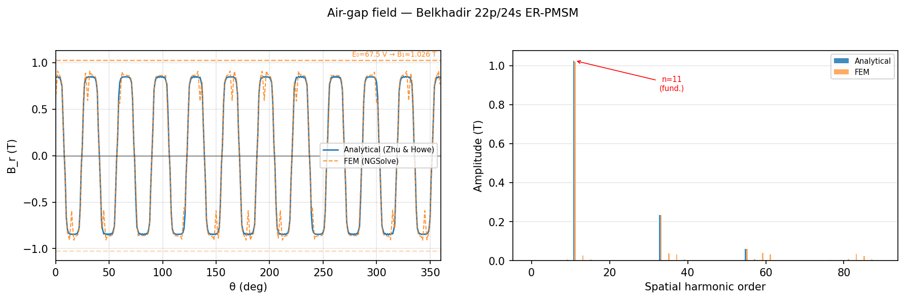

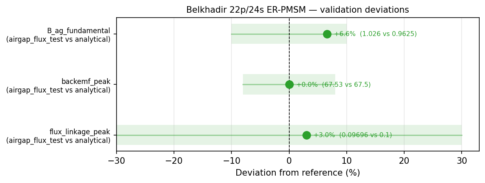

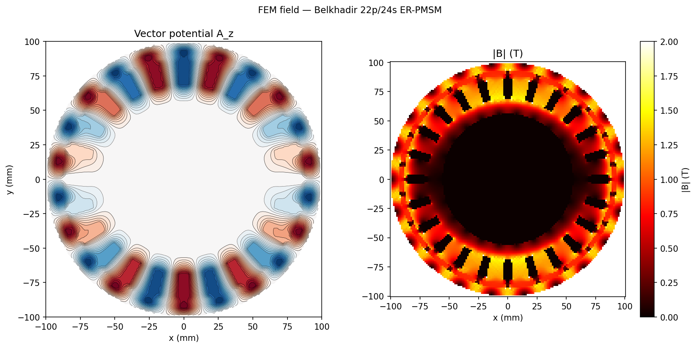

### Deylami 8p/12s Cooling Fan

8-pole / 12-slot outrunner from Deylami et al. (TechRxiv). FEM passes the
airgap flux comparison; the analytical model exceeds the tolerance.

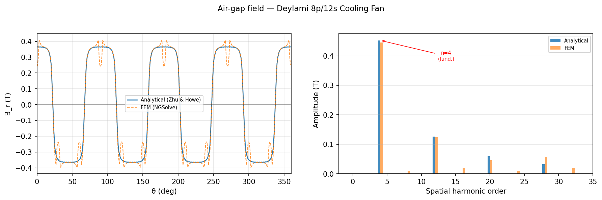

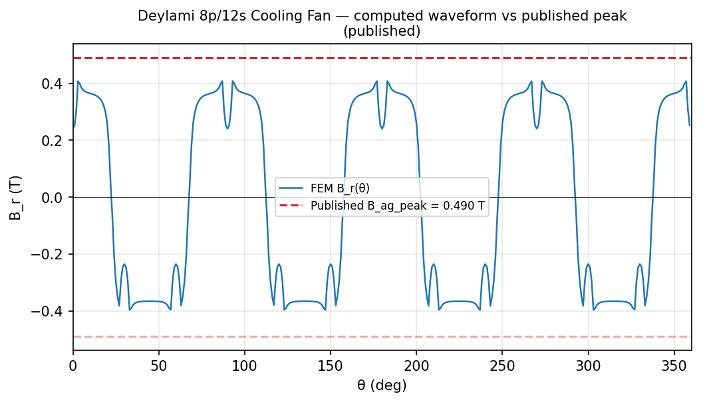

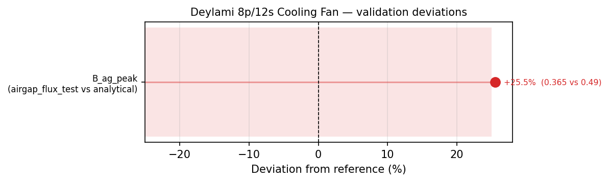

### 14 mm Outrunner (Steel)

12-pole / 9-slot outrunner (bench-measured with RTB2004 oscilloscope).
Most of the remaining, end-effect-corrected back-EMF discrepancy reflects the gap
between nominal and calibrated effective remanence, not a measurement error.

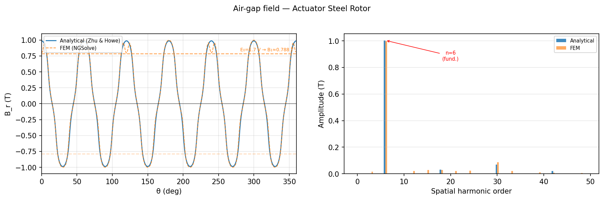

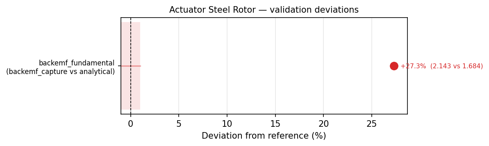

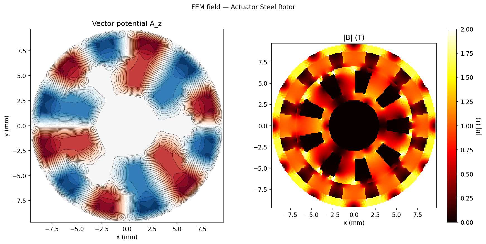

## Additional Comparisons

The following motors have validation anchors and cross-validation tests
(`pytest tests/crossval/`) but are not included in the report
figures above:

| Motor | Source | Quantities Tested |
|-------|--------|-------------------|
| Toyota Prius 2004 IPM | ORNL/TM-2004/185 | stall torque ≥ 340 Nm, MTPA angle |
| Awan 2.2 kW IPM | Aalto dissertation | saliency ratio, rated torque ≥ 14 Nm |
| ETEL TMB (5 sizes) | ETEL datasheet | envelope bands, copper loss vs datasheet Pc, reverse-salient MTPA, stall-torque bounds (`psi_f` is fitted from Ku, so back-EMF is not tested) |
| Rexroth MS2N04 | Bosch Rexroth manual | KE/KM convention, rated-point voltage feasibility, envelope corner (`psi_f` fitted from KE) |
| Tecnotion QTR-A-105 | Tecnotion datasheet | hot-R reconstruction from Pc, max speed at two bus voltages (`psi_f` fitted from Ke) |
| JMT 1806 2400KV | bench measurement | back-EMF speed sweep (8 speeds) |
| Parviainen 5 kW AFPM | LUT D.Sc. thesis | back-EMF 211 V (`analytical_axial`); `fem_axial` bracket only - see below |
| CREATOR Case IM | TU Graz CREATOR dataset (DOI 10.3217/kh3v7-dhn98) | locked-rotor current (45 points, ≤2.5 %), torque-slip, nameplate, friction/windage. Iron loss is not validated: the stator-core estimate under-predicts measured no-load loss ~3.9× (pinned). Details: `data/creator_case_im/README.md` |
| NWPU 12 kW Halbach SPM | WEVJ 16(8):413 (2025) | Halbach vs radial FEM B1 and THD (`psi_f` fitted from the measured 75.2 V back-EMF, so that row is by construction) |
| Jilin 5.5 kW SynRM | PMC11679518 (2024) | reluctance-only MTPA through rated_torque/torque_speed/thermal_duty/drive_sim |
| BMW i3 2016 IPM | Gierczynski & Grzesiak 2021 (FEM flux map), Burress 2017 (ORNL) | numeric MTPA on the flux map within 1 % of the source torque sheet; hot peak torque bracketed (map temperature unpublished); the `motor_thermal` fit is a pin, not a validation |

### Axial-Flux FEM (`fem_axial`)

`fem_axial` is verified by code-to-code and limit comparison rather
than by a measured back-EMF gate:

| Check | Result |
|---|---|
| Mirror BC vs true periodic identification | 2–3·10⁻⁵ on B1 |
| Slotless plane vs analytical layer model | 0.06% |
| Cross-code vs Elmer (independent solver) | 0.39% at the motor's mu_r_fe = 1000; 0.001% with ideal iron |
| 1D magnetic-circuit limit | 0.06% |

It is **not** gated on the Parviainen E_PM: that anchor does not
publish its slot opening, and the explicit-slot model spans
192.6–234.3 V across the plausible slot geometry, so the anchor cannot
discriminate. The crossval test asserts that the measured value falls
inside that bracket. `analytical_axial` remains the E_PM-gated axial
model.

### Radial FEM Cross-Code (Elmer)

The radial `fem` model is cross-checked against ElmerFEM (independent code,
mesh, basis, and nonlinear linearization) on surface-PM inrunner cases covering
smooth bore, discrete magnet arcs, nonlinear BH, slots, and armature
current sheet (`scripts/elmer_radial/`, pinned JSON re-checked by
`tests/crossval/test_elmer_radial_pinned.py`):

| Check | Result |
|---|---|
| Slotless and nonlinear cases, B₁ at r_ag | 0.07–0.11% |
| Slotted cases (open-circuit and j_s) | 0.17–0.21% |
| Linear slotless cases vs Zhu/Howe/Chan series | ≤ 0.2% |

Rotation/cogging is excluded from the cross-check: the mean field
agrees, but the sub-0.1% ripple over a slot pitch is discretization
noise in both codes at these mesh levels.

## How Validation Works

Each validation anchor is a JSON file in `data/<motor>/` containing a
published or measured value, its source, tolerance, and comparison method:

- **Delta**: direct percentage comparison (most quantities)
- **Bound**: inequality check - e.g., rated torque ≥ published rating
- **Curve**: extract a scalar from a computed waveform (e.g., max of B_r)
  and compare to a published value

The `phasesweep.validation.crossval` module computes deviations, applies
tolerances, and produces structured pass/fail diagnostics.

## Reproducing This Report

```bash
uv sync --extra all
uv run python scripts/validation_report.py --no-sensitivity --workers 4
```

To include sensitivity analysis, omit `--no-sensitivity`:

```bash
uv run python scripts/validation_report.py --workers 4
```

Output goes to `output/validation_report/` (gitignored).
